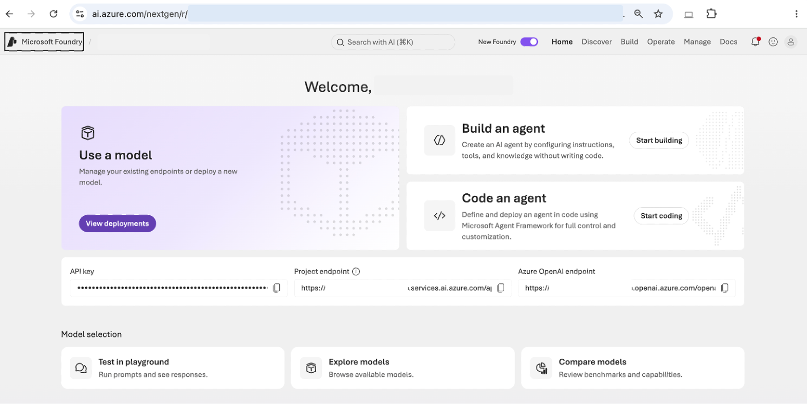
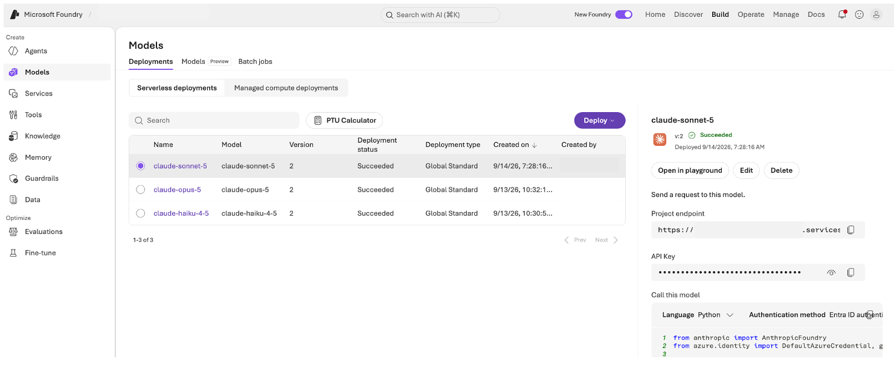
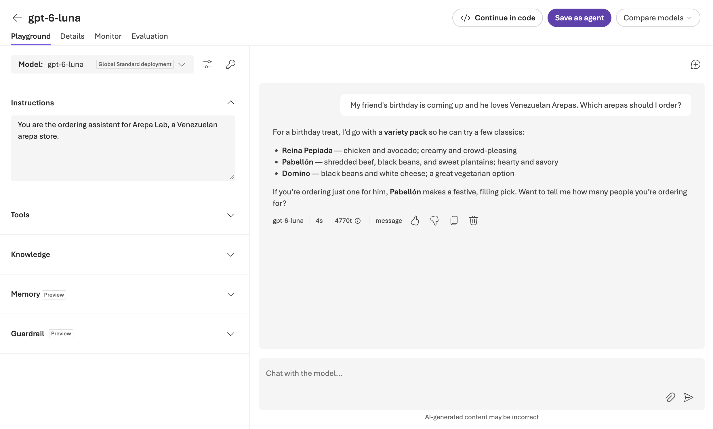

## Module 1.0: Instructions are not store knowledge (5 minutes)

No code yet. Give the assistant a role, then examine what facts it actually
has. This time includes the lab introduction.

### Sign in

1. Sign in to the virtual machine:

   **Username**: `@lab.VirtualMachine(Windows11).Username`

   **Password**: `@lab.VirtualMachine(Windows11).Password`

2. Open **Microsoft Edge** from the Windows taskbar.
3. Go to `https://ai.azure.com` and use the workshop account:

   **Username**: `@lab.CloudPortalCredential(User1).Username`

   **Access Pass**: `@lab.CloudPortalCredential(User1).AccessToken`

   >[!note]The sign-in details are also on the Resources tab.

4. If the top bar has a **New Foundry** toggle, make sure it is turned on.
5. From the project listings on the main page, select the pre-created
   project. There should only be one.
6. If a dialog pops up, select the close or **Skip** button.



### Open the configured deployment

Choose **Build > Models > Deployments**. Open the deployment matching
`FOUNDRY_MODEL_DEPLOYMENT` in the root `.env`, then **Open in playground**.
You need only this deployment, even if others are listed.



> A model is the underlying capability. A deployment is the named endpoint
> configured in your project. The agent adds instructions, state, and tools
> around that client.

### Give it a role

In the **Instructions** panel, paste:

```text
You are the ordering assistant for Arepa Lab, a Venezuelan arepa store.
```

Ask:

```text
My friend's birthday is coming up and he loves Venezuelan Arepas. Which arepas should I order?
```

### Check the source, not the confidence

The reply might suggest plausible items, ask for more information, or admit
that it does not know. Whatever the wording, this conversation has no live
menu connection. A familiar item name is not proof of availability or price.

Now ask: `What's your refund policy?`

If it fabricated a reasonable-sounding policy, that is the risk: confidence
without a source. If it admits not knowing, that is the right boundary.
Nothing in this conversation establishes Arepa Lab's actual refund policy.

In Module 1.2, tools
will provide live store data. In Module 1.3, a knowledge base will provide
documented store information.


### Look at the code

Click the **Continue in code** button. This is the same call you will make from Python in the
next module. Note the three things it needs: the endpoint, a key, and the
deployment name.



The screenshot is illustrative. Use the deployment specified by
`FOUNDRY_MODEL_DEPLOYMENT` in your root `.env`; your response may differ.

**Checkpoint 1.** You can distinguish instructions from a source of store
facts. You have located the one deployment the agent will use.
