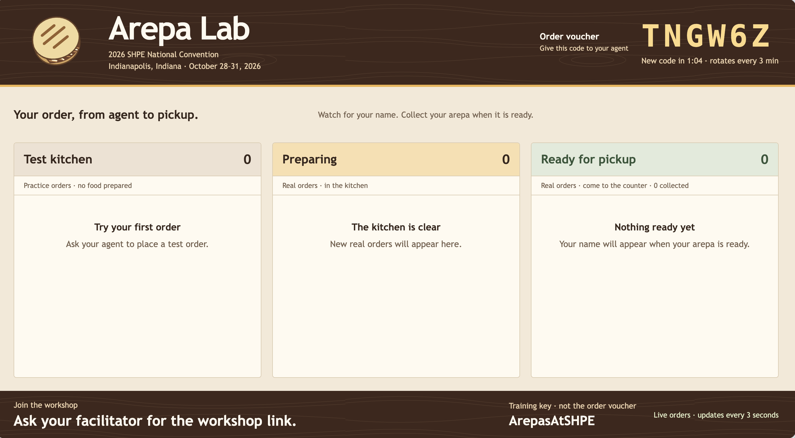

## Module 1.2: Live tools and a store persona (12 minutes)

An agent that only chats cannot register a customer or place an order.
The Arepa Lab **MCP server** provides those tools and the store's persona.

> Model Context Protocol (MCP) connects clients to servers exposing tools,
> prompts, and resources. Our store publishes tools and prompts over
> Streamable HTTP; a server does not have to publish all three.

### Prepare the changes

Check `AREPA_MCP_URL` in the root `.env`:
`https://ca-arepa-mcp.yellowbeach-684b8340.eastus.azurecontainerapps.io/mcp/`.
Use the trailing-slash canonical path. Azure resource names stay unchanged.

From `arepa-agent/`, back up your current file:

```powershell
Copy-Item agent.py agent-before-1.2.py
```

**Fast path:** copy the completed version, then read the additions below:

```powershell
Copy-Item snapshots/agent-module-1.2.py agent.py
```

**Edit path:** replace the import section with this block, then replace the
entire `main()` function with the next block. Keep the existing root `.env`
loader, `reply` function, and final entry point unchanged.

<!-- build: imports -->
```python
import asyncio
import os
from contextlib import AsyncExitStack
from pathlib import Path

from dotenv import load_dotenv

from agent_framework import Agent, MCPStreamableHTTPTool
from settings import ToolTrace, create_chat_client
```

### Tools first, then the persona

In the function below, section **3** connects the tools and registers cleanup.
Section **4** fetches two server prompts: `agent_instructions` supplies the
persona, and `welcome_banner` is printed once by the client. Section **5**
passes the tools and persona to the agent. `ToolTrace` from `settings.py`
prints tool names without their arguments or full results.

<!-- build: main -->
```python
async def main() -> None:
    # 2. Keep the same configured model client.
    chat_client = create_chat_client()

    # 3. Discover the store tools; close the connection on exit or error.
    async with AsyncExitStack() as stack:
        arepa_tool = MCPStreamableHTTPTool(
            name="arepa-store",
            url=os.environ["AREPA_MCP_URL"],
        )
        await arepa_tool.connect()
        stack.push_async_callback(arepa_tool.close)

        # 4. Fetch the server-owned persona and client-rendered banner.
        instructions = await arepa_tool.get_prompt("agent_instructions")
        banner = await arepa_tool.get_prompt("welcome_banner")

        # 5. Add tools and instructions; trace only tool names.
        arepa_agent = Agent(
            client=chat_client,
            name="arepa-agent",
            instructions=instructions,
            tools=arepa_tool,
            middleware=[ToolTrace()],
        )

        # 6. Keep one session and let the agent greet the customer first.
        arepa_session = arepa_agent.create_session()
        print(banner)
        print("Type 'exit' to quit.\n")
        response = await arepa_agent.run("hello", session=arepa_session)
        print(f"Arepa Lab:\n{reply(response)}\n")

        # 7. The agent chooses tools during each conversational turn.
        while True:
            user_input = input("You:\n").strip()
            if user_input.lower() in ("exit", "quit"):
                break
            if not user_input:
                continue
            response = await arepa_agent.run(user_input, session=arepa_session)
            print(f"\nArepa Lab:\n{reply(response)}\n")
```

Tools make actions possible; the server's instructions guide the ordering
flow. `AsyncExitStack` closes the connection on normal exit and on exceptions.

### Run, register once, and inspect the menu

```powershell
python agent.py
```

Answer the agent's greeting:

1. **New customer:** provide your first name, last name, and city. The agent
   calls `register_customer` and shows your permanent eight-character ID.
2. **Returning customer:** provide your existing ID. The agent calls
   `get_customer` before continuing.

> **Copy your customer ID now.** Reuse it for the rest of the lab.
>
> @lab.TextBox(customerID)

Do not create a second identity to get another real order.
Ask `Show today's menu only; do not place an order.`
Watch for `[tool] list_arepas`. Check that **every returned item** appears in a
numbered list with its **name, description, USD price and `stock_label`**.
If a description is missing, the agent must say it is unavailable instead of
inventing one. An empty menu must not produce invented choices. Machine IDs
stay internal. These presentation instructions belong to the server prompt;
do not add a competing menu renderer or persona to the client.

### Make one explicit order

Choose a current item by name or number, then choose:

- **Test:** practice only; no stock is consumed and there is no pickup.
- **Real:** an actual arepa for pickup. Each customer can receive one real
  arepa. If you have already used yours, choose test.

Open the dashboard using the host in `AREPA_MCP_URL`, replacing `/mcp/`
with `/dashboard`, or use the instructor's projected dashboard.
Read the current six-character voucher **last**, after the item and kind
are chosen. Both kinds require it. If rejected, reread the display and follow
the recovery instructions; do not keep guessing.



Use the **Order voucher** at the top right, not the **Training key** in the
footer. The pictured voucher is illustrative; read the current code from
the live dashboard.

Watch the `order_arepa` call and reply:

- Collect a real order only when the dashboard says **Ready for pickup**.
  Look for your displayed board name and follow staff directions.
- A test order completes automatically in **Test kitchen**. It is not tracked
  as an active real order by `check_order_status`.
- A failed tool call is not a successful order. Follow the correction prompt;
  if stock changed, choose again from a refreshed menu.

Type `exit`. Module 1.4 adds receipt support; use its simulated example or
a test order, not another real order.

**Checkpoint 3.** Your agent used live tools and the server persona to
show every returned menu item in a numbered list with its name, description,
USD price and `stock_label`, then complete an explicit test or real order.
You saved your customer ID.
