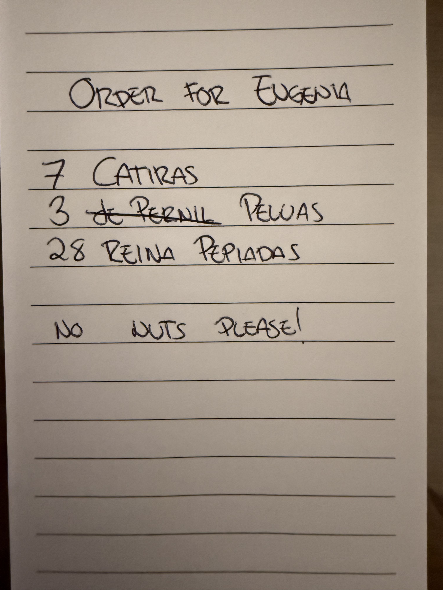

## Module 1.5: Read and work a handwritten request (8 minutes)

A catering request arrives as a photo. It has handwritten quantities, a
crossed-out item with a replacement, and an allergy note. We will extract
and review it, not pretend that the whole request has been accepted.

### Inspect the note

Open `written_order.jpg` on the **Desktop** of your Skillable VM.
The same photo is included in the repository at
[`lab/images/written_order.jpg`](images/written_order.jpg).
It shows Eugenia, seven Catira, Pernil crossed out for three Pelua,
twenty-eight Reina Pepiada, and the allergy note `No nuts please!`.
The quantities are written as numbers, not tally marks. Compare them yourself
before trusting extraction; the total is **38 arepas**.



This request exceeds the retail bulk threshold. The knowledge base says
25+ arepas require 72 hours' notice and a 50% deposit. That policy does not
make the workshop counter capable of catering checkout.

### Inspect the script

Open `arepa-agent/catering.py`. It performs three steps:

1. `read_order` reads the local JPEG, encodes it as an image block, and sends
   it to the configured model. It extracts items, quantities, corrections,
   allergy notes and uncertainties into `ORDER_SCHEMA`. The prompt mentions
   tally marks, but this photo uses written numbers; verify those values.
2. `work_order` gives the request to an agent connected to the store and
   Foundry IQ. It checks the live menu, looks up allergen and bulk-order
   policy, and explains what staff must handle. Allergy suitability goes
   to staff; the agent must not infer that an item is safe.
3. The script prints a receipt for the **whole request**, labeled
   `requested`, not accepted or paid. A successful counter test, if made,
   gets its own confirmed single-item summary.

### Run it

Exit the Module 1.4 agent by typing `exit`. Keep the supplied root `.env`
unchanged; this helper uses the same model, live counter and Foundry IQ
configuration. You do not need to edit `agent.py` or attach the photo in the
Foundry playground.

In the VS Code PowerShell terminal, work from `arepa-agent/`. If you opened
a new terminal at the project root, run `cd arepa-agent` once.

Use the Desktop photo:

```powershell
$orderPhoto = Join-Path ([Environment]::GetFolderPath('Desktop')) 'written_order.jpg'
Test-Path -LiteralPath $orderPhoto
```

The check should print `True`. Then send the image to the model:

```powershell
python catering.py "$orderPhoto"
```

If the Desktop check prints `False`, use the identical repository photo
instead:

```powershell
python catering.py "../lab/images/written_order.jpg"
```

Pass the image path explicitly as shown; the script's no-argument default
points to a different, unprovided photo. Keep quotes around paths, especially
when they contain spaces. A missing-file error means the photo has not been
read or sent; check the path and current terminal directory before retrying.

If vision cannot be completed, ask the instructor before using the catch-up
path. It uses prepared JSON and explicitly skips vision:

```powershell
python catering.py --extracted examples/request.json
```

Before any store tools run, the script prints the extracted JSON and asks
`Does this extraction match the note? Type 'yes' to continue:`.
Compare the customer, all three quantities, replacement, allergy note and
any uncertainties with the photo. Type `yes` only if they match. Otherwise
type `no` to stop and ask the instructor to correct the extraction before
rerunning; do not approve incorrect JSON just to continue.

Read the policy/menu review. If time permits, explicitly authorize **one test
order**, choose a current menu item, and give your saved customer ID
**@lab.Variable(customerID)**. Provide the current dashboard voucher last.
This tests the counter flow, not food safety or acceptance of catering.
The script blocks real orders and does not expose registration or cancellation.

Type `done` to print the request receipt. You can finish without ordering.

### Check the result

- Did the image command print `Compare this extraction with the photo before using it:`?
  `PRE-EXTRACTED FALLBACK: vision was not run.` means only the fallback ran.
- Is the customer Eugenia, with quantities 7, 3, and 28 (38 total) and Pelua
  replacing Pernil rather than adding a fourth item?
- Is the allergy note verbatim, with no safety assurance?
- Did the agent retrieve the 25+ threshold, 72-hour notice, and 50% deposit?
- Did it check current menu availability rather than assume it?
- Does the full-request receipt remain labeled `requested`, with no claim
  that catering was accepted or a deposit paid?

**Checkpoint 6.** A handwritten request was extracted and checked against
store policy and live tools. Any single-item test order is distinct from
the unconfirmed catering request. The JSON fallback does not validate vision.
